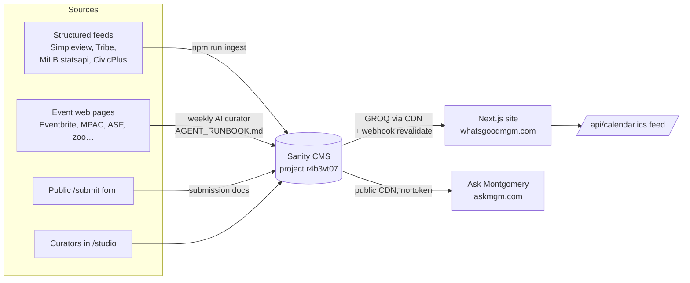

# WhatsGoodMGM

**Know what's good in the Gump.** A curated calendar of things to do in Montgomery, Alabama: concerts, festivals, family activities, nightlife, sports, arts, and community events.

Live: **https://whatsgoodmgm.com** · Built by [MM Intelligence](https://www.mmintelligence.ai)

WhatsGoodMGM is the sister site to [Ask Montgomery](https://askmgm.com), MMI's civic-data AI assistant. Ask Montgomery's `find_events` tool reads this site's events straight from Sanity's public CDN, so the data here powers "what's happening this weekend?" answers there too.

---

## How it works



- **Sanity is the only datastore.** Document types: `event`, `venue`, `source`, `submission`, `contributor`, `weeklyPick` (`sanity/schemaTypes/`). Only `status == "approved"` events are shown.
- **Recurring events** (weekly, biweekly, monthly) are stored once and expanded into dates in code: `src/lib/events/occurrences.ts`.
- **Pages are static with hourly refresh** (`revalidate = 3600`). A Sanity webhook calls `/api/revalidate` so edits show up within seconds.
- **Flyers are hotlinked** from the source sites (`imageUrl`). Known hosts go through `next/image` (`src/lib/images.ts`); others render unoptimized.

## Quickstart

Requirements: Node 20+ (CI uses 24), npm.

```bash
git clone https://github.com/thebadcoder96/whatsgoodmgm.git
cd whatsgoodmgm
npm ci
cp .env.example .env.local   # then fill in values (see below)
npm run dev                  # http://localhost:3000
```

The site reads public data, so for local browsing you only need the two `NEXT_PUBLIC_SANITY_*` values. Studio (`/studio`) needs a Sanity login with access to the project.

### Environment variables

| Variable | Needed for | Where it comes from |
|---|---|---|
| `NEXT_PUBLIC_SANITY_PROJECT_ID` | Everything | Public: `r4b3vt07` |
| `NEXT_PUBLIC_SANITY_DATASET` | Everything | Public: `production` |
| `NEXT_PUBLIC_SITE_URL` | Absolute URLs (sitemap, OG, JSON-LD) | `https://whatsgoodmgm.com` in production; leave unset locally |
| `SANITY_WRITE_TOKEN` | Ingest, scripts that write, `/submit` | Sanity manage → API → Tokens. **Maintainers only.** |
| `REVALIDATE_SECRET` | `/api/revalidate` webhook | Shared with the Sanity webhook. Maintainers only. |
| `SANITY_PROJECT_ID` | `sanity` CLI (dataset export/backups) | Same value as the public one |
| `VERCEL_PROJECT_PRODUCTION_URL` | Fallback site URL | Set automatically by Vercel |

> **Vercel note:** project env vars are currently set for **Production only**. Preview deployments (one per PR) fail with `Configuration must contain projectId` until `NEXT_PUBLIC_SANITY_PROJECT_ID` and `NEXT_PUBLIC_SANITY_DATASET` are also added to the **Preview** environment. Don't give Preview the write token.

## Scripts

| Command | What it does |
|---|---|
| `npm run dev` / `build` / `start` | Next.js dev server, production build, serve the build |
| `npm run lint` | ESLint (must have 0 errors) |
| `npx tsc --noEmit` | Typecheck |
| `npm test` | Vitest unit tests (fetchers, dedupe, recurrence, ICS, filters) |
| `npm run ingest -- --all [--dry-run]` | Pull the next 60 days from every structured source into Sanity |
| `npx tsx scripts/write-extracted.ts <file.json> [--dry-run] [--pending]` | Write AI-extracted events (weekly runbook step 3) |
| `npx tsx scripts/tag-interests.ts` | Tag new events with interests. **No dry-run; writes immediately.** |
| `npx tsx scripts/geocode-venues.ts [--dry-run]` | Pin venues that have no coordinates (OpenStreetMap, rate-limited) |
| `npx tsx scripts/seed-sources.ts` | Create or sync `source` documents |
| `npx tsx scripts/crawl-check.ts [baseUrl]` | Hit every page and event URL and report failures |
| `npx tsx scripts/build-brand.ts` | Regenerate icons and OG art from `public/logo.svg` |

## Project layout

```
src/
  app/(site)/        public pages: home, events/[slug], calendar, map, archive, about, submit, privacy
  app/api/           calendar.ics (ICS feed), revalidate (Sanity webhook)
  app/studio/        embedded Sanity Studio at /studio
  components/        UI (event list/rows, filters, map, flyers)
  lib/events/        recurrence, filtering, grouping, categories, interests
  lib/sanity/        client + GROQ queries
  lib/seo/           JSON-LD (Event, WebSite)
ingest/
  fetchers/          one file per source platform (+ tests and fixtures)
  lib/               normalize, validate, dedupe, writer
  run.ts             entry point for `npm run ingest`
sanity/              schemas, Studio structure, approve action
scripts/             maintenance scripts (see table above)
AGENT_RUNBOOK.md     instructions for the weekly AI curator
docs/SETUP.md        one-time setup: webhook, GitHub secrets, scheduled agent
```

## Operations

- **Deploy:** open a PR. A maintainer (Mishal or Mazin) reviews and merges it, and Vercel (Hobby team) ships `main` to production automatically. Contributors never push to `main`.
- **Weekly refresh:** a scheduled Claude Code agent runs `AGENT_RUNBOOK.md` on Mondays (6 AM Central). It runs the structured ingest, reads a list of trusted event pages, writes events, tags interests, and posts a digest. Setup lives in `docs/SETUP.md`.
- **Manual ingest:** `npm run ingest -- --all --dry-run` first, read the digest, then run without `--dry-run`.
- **Venue pins:** `npx tsx scripts/geocode-venues.ts --dry-run`, review the ACCEPTED/REJECTED table, then run for real. Only rooftop-level matches are saved.
- **Refresh the site now:** `curl -X POST "https://whatsgoodmgm.com/api/revalidate?secret=$REVALIDATE_SECRET"` (otherwise pages refresh within an hour).
- **Backups:** `.github/workflows/backup.yml` exports the Sanity dataset every Sunday and keeps it 90 days as a workflow artifact.
- **Search Console:** `whatsgoodmgm.com` is verified under the MM Intelligence Google account.

## Known gaps

- About 50 venues have no map coordinates because their address is missing or too vague. They still list, just not on the map or in "near me" sorting.
- Flyers are third-party hotlinks and can break when a source site changes.
- The Vercel Hobby plan's ISR-write allowance is the tightest limit; watch Usage in the Vercel dashboard.
- Preview deployments fail until Preview env vars exist (see above).

See the repo's GitHub issues for planned work, including ones labeled `good first issue`.

## Contributing

Read [CONTRIBUTING.md](CONTRIBUTING.md) before opening a PR.

---

© MM Intelligence. Internal project, all rights reserved.
